<div align="center">

# 🎓 IELTS AI Practice Platform

**Full-length IELTS practice for Speaking, Writing, Listening and Reading — with instant, criteria-based band scores from an AI that runs entirely on your own machine.**


[Features](#-features) · [Screenshots](#-screenshots) · [Architecture](#-architecture) · [Getting Started](#-getting-started) · [API](#-api-reference) · [Project Structure](#-project-structure)

<br />

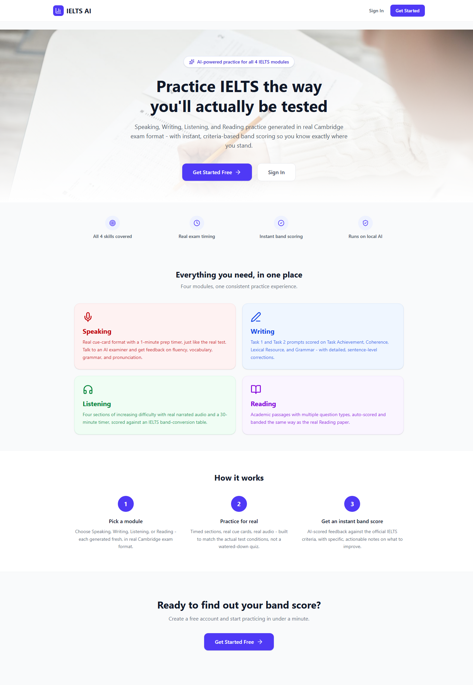

</div>

---

## 📖 Overview

IELTS AI is a full-stack practice platform that recreates the four IELTS modules under real exam conditions — timed sections, cue cards, narrated audio, split-screen reading — and grades every attempt against the official IELTS band descriptors.

Unlike most AI tutoring tools, **no data leaves your machine**. All generation and grading runs through a locally hosted [Ollama](https://ollama.com) model (`qwen2.5:3b`), with [Piper](https://github.com/rhasspy/piper) for text-to-speech and [faster-whisper](https://github.com/SYSTRAN/faster-whisper) for speech-to-text, both loaded in-process. There are no API keys, no per-request costs, and no third-party processing of student essays or voice recordings.

## ✨ Features

| Module | What the student gets |
| --- | --- |
| 🎤 **Speaking** | Parts 1–3 across 9 topic areas (or a custom topic). An AI examiner (male or female voice) asks questions aloud, gives a 1-minute note-prep timer for the Part 2 cue card, records the answer in the browser, transcribes it with Whisper and scores **Fluency, Lexical Resource, Grammar and Pronunciation**. |
| ✍️ **Writing** | Task 1 (chart description, with an interactive bar / line / pie / table visualiser) and Task 2 (essay) on a 20 + 40 minute timer with live word counts. Essays are scored on **Task Achievement, Coherence & Cohesion, Lexical Resource and Grammatical Range**. |
| 🎧 **Listening** | Multi-section tests with Piper-narrated audio, a playback-speed control, a 30-minute timer and a per-section breakdown converted to a band score. |
| 📖 **Reading** | Split-screen exam mode — passage on the left with font zoom and highlighting, questions on the right — auto-marked and converted to a band score with an answer-by-answer breakdown. |
| 📊 **Dashboard** | Target band, total and completed tests, average and best band, per-skill progress and a recent activity feed. |

**Platform highlights**

- 🔒 **100% local AI** — Ollama, Piper and Whisper run on your own hardware.
- ⚡ **Pre-generated content** — questions, prompts, passages and audio are generated offline and stored, so students load a test instantly instead of waiting on the LLM.
- 🧪 **Validated generation** — AI output is checked for format and relevance before it is saved, and essays or spoken answers that are off-topic are caught before scoring.
- 📐 **Official band rounding** — scores follow IELTS rules (e.g. `.25` rounds up to `.5`, `.75` to the next whole band).
- 🔐 **JWT authentication** with bcrypt-hashed passwords and protected routes.

## 📸 Screenshots

> All screenshots are captured from a local run of the platform. Every question, passage, chart and score shown was generated or graded by the local `qwen2.5:3b` model.

### Dashboard
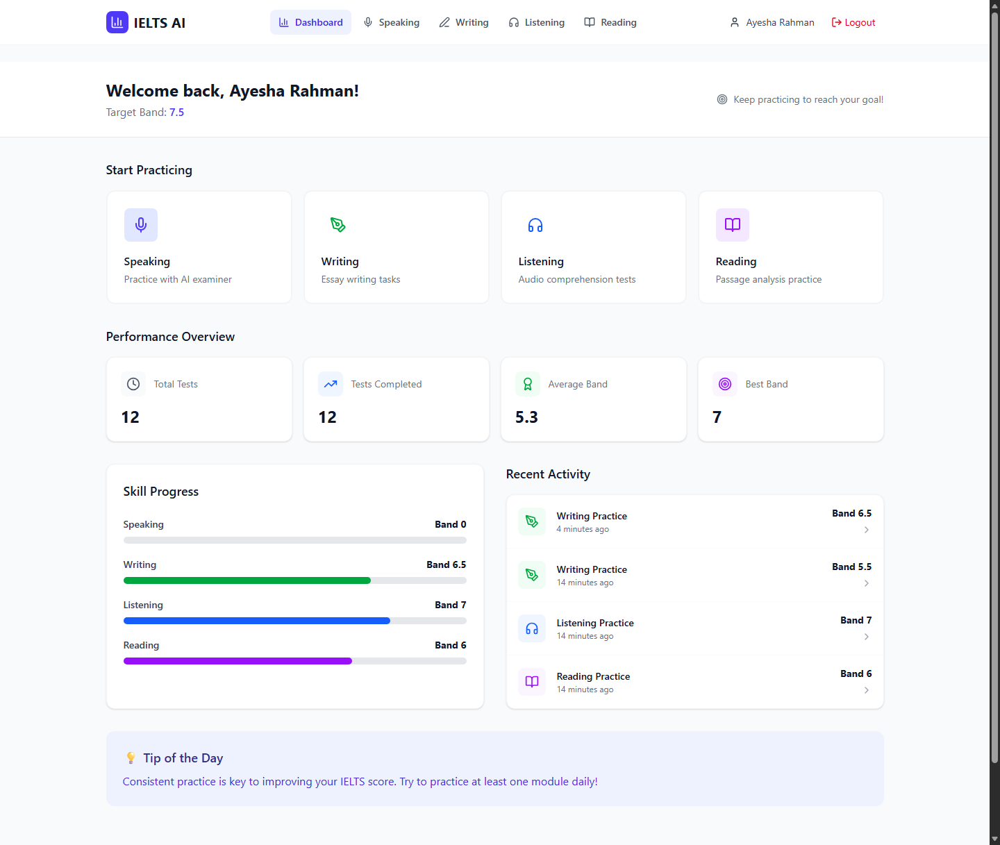

### Speaking — session setup and live AI examiner
<table>
  <tr>
    <td width="50%">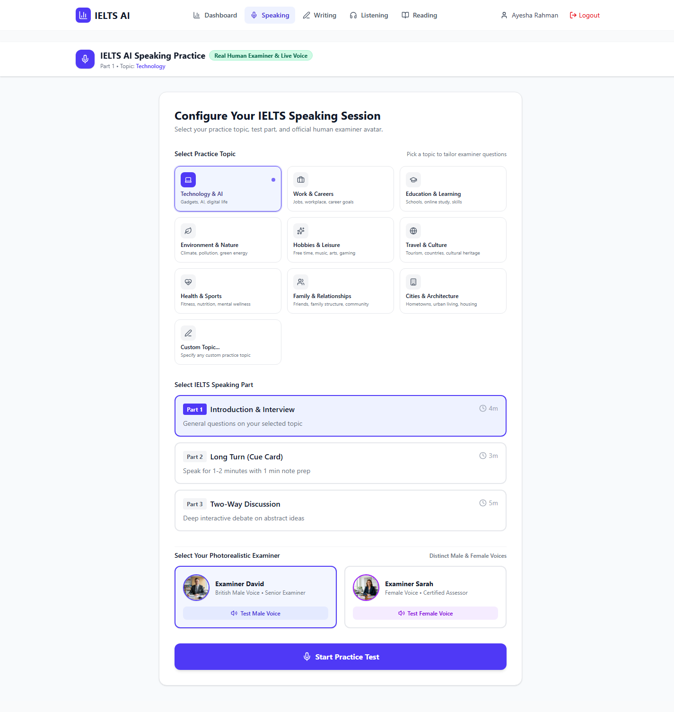</td>
    <td width="50%">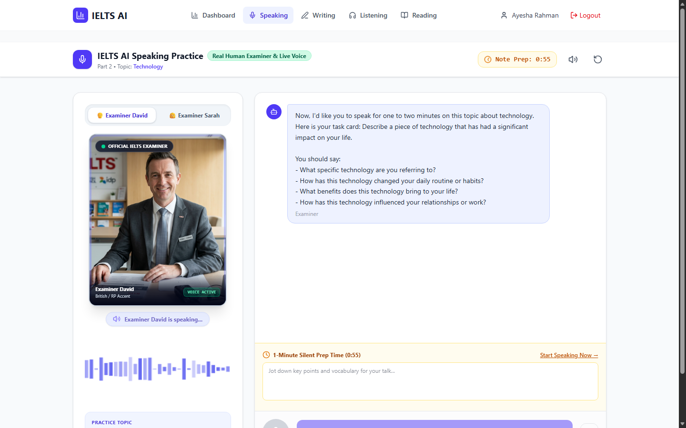</td>
  </tr>
  <tr>
    <td align="center"><sub>Choose a topic, a Speaking part and an examiner voice</sub></td>
    <td align="center"><sub>Part 2 cue card with 1-minute silent note prep</sub></td>
  </tr>
</table>

### Writing — timed tasks and AI band score
<table>
  <tr>
    <td width="50%">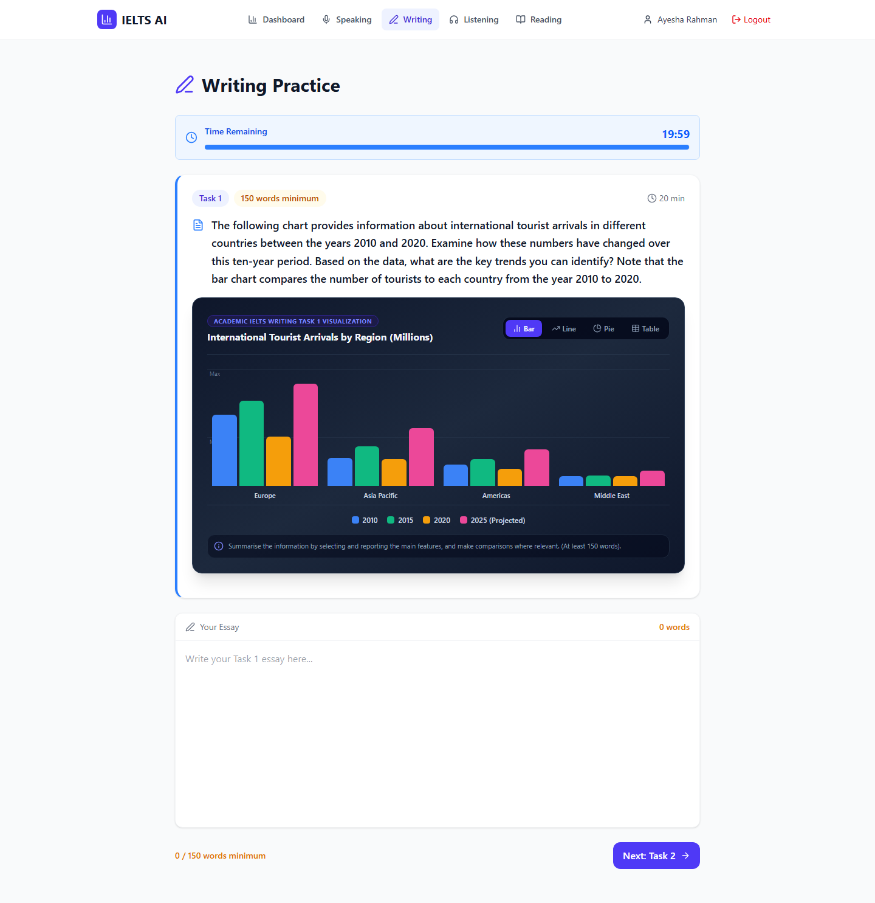</td>
    <td width="50%">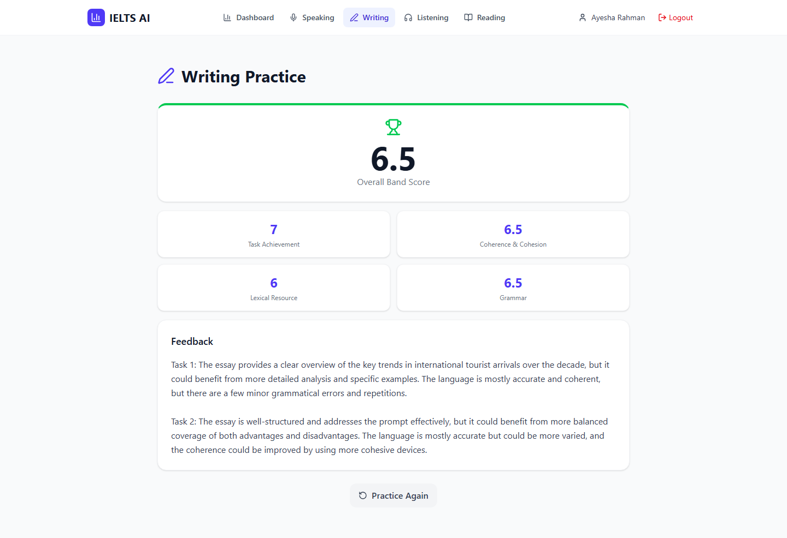</td>
  </tr>
  <tr>
    <td align="center"><sub>Timed Task 1 with an interactive bar / line / pie / table chart</sub></td>
    <td align="center"><sub>Criteria-based band score and examiner-style feedback</sub></td>
  </tr>
</table>

### Reading — split-screen exam mode and results
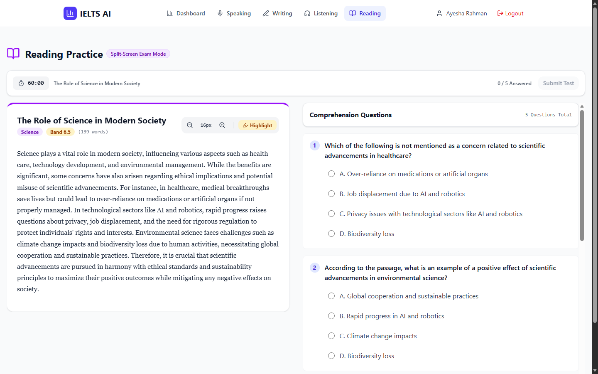

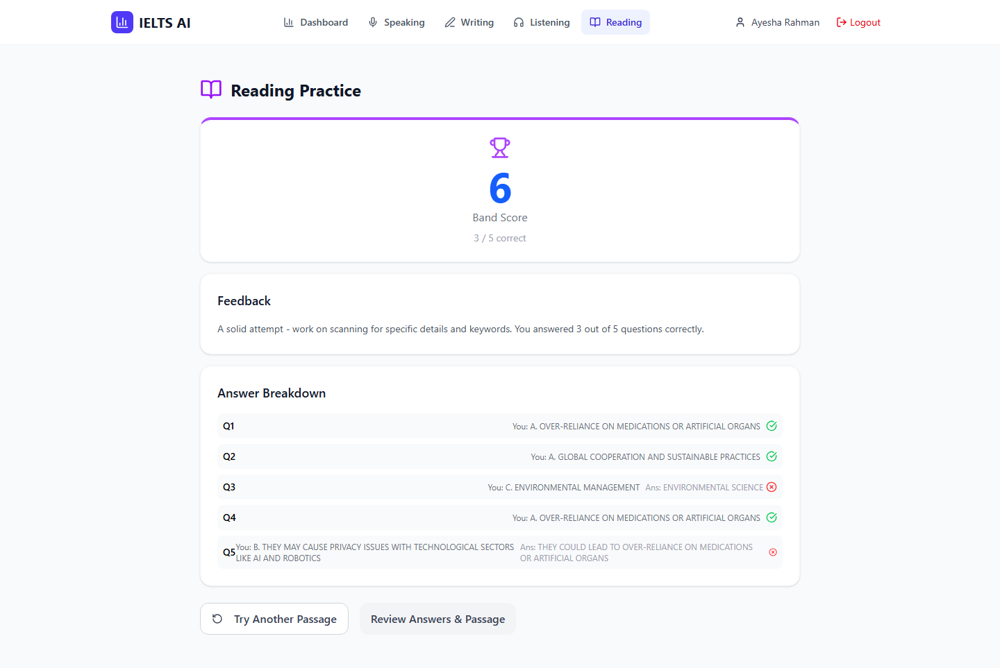

### Listening — narrated test and answer review
<table>
  <tr>
    <td width="50%">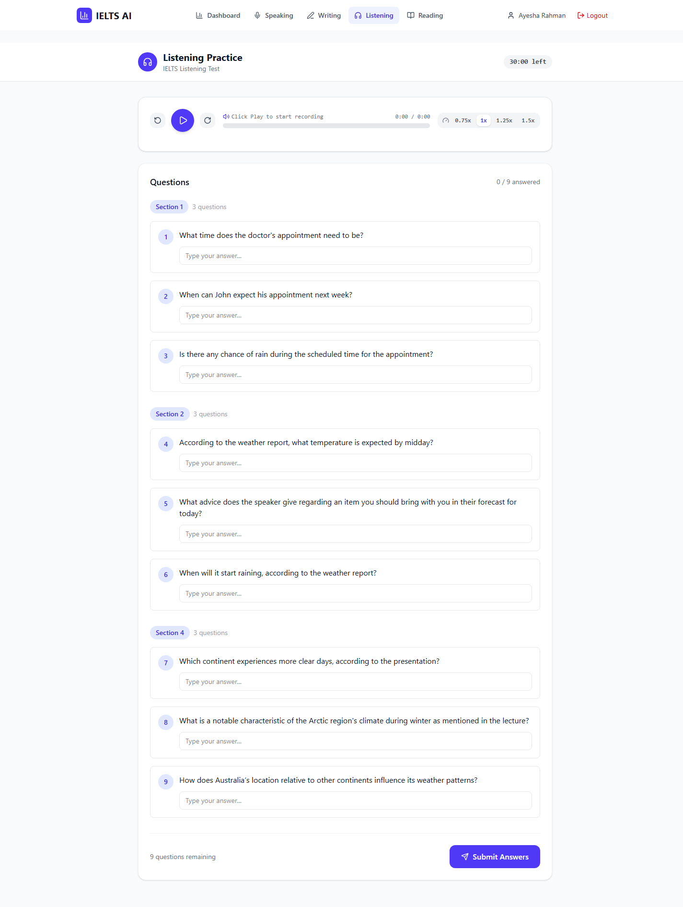</td>
    <td width="50%">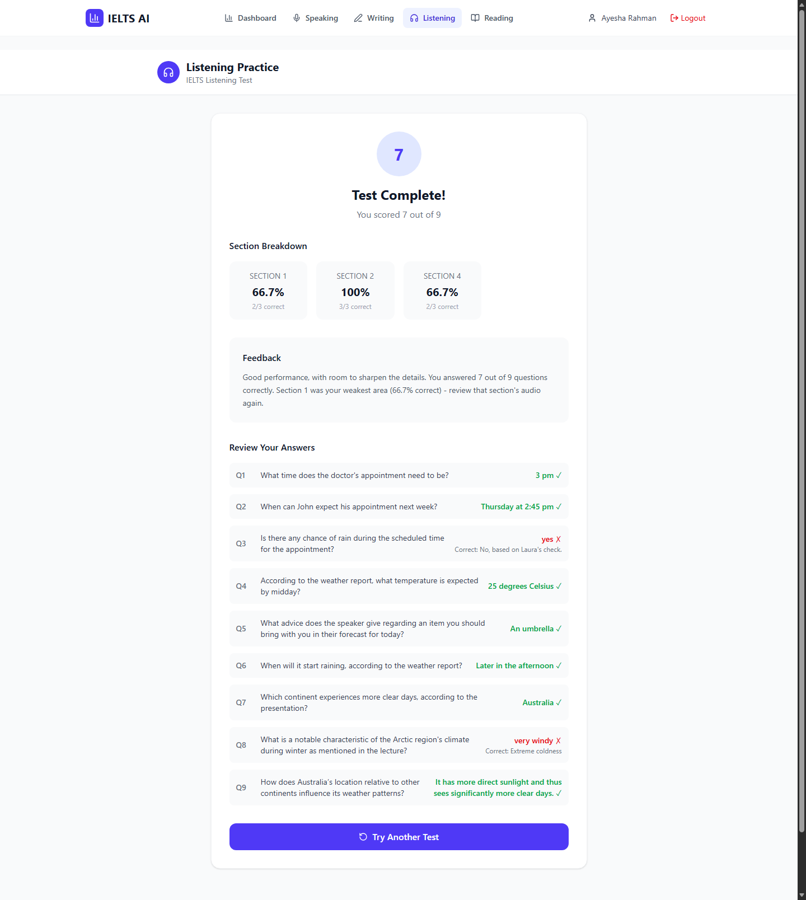</td>
  </tr>
  <tr>
    <td align="center"><sub>Piper-narrated audio with speed control and sectioned questions</sub></td>
    <td align="center"><sub>Band score, section breakdown and correct answers</sub></td>
  </tr>
</table>

## 🏗 Architecture

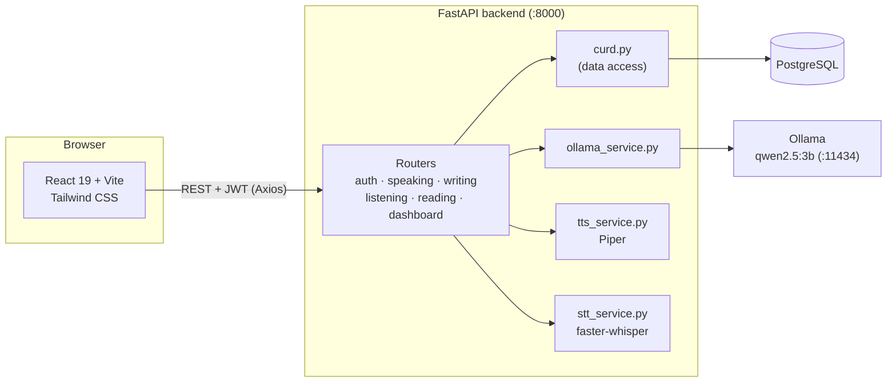

### Offline / live content pattern

Every module follows the same two-phase design so that students never wait on a slow local LLM during a test:

1. **Offline (generation)** — a `generate-*` endpoint or seed script asks the LLM for new content (a speaking question, writing prompt, reading passage or listening script), validates it, and stores it in PostgreSQL. Listening scripts are narrated to WAV files by Piper at this stage.
2. **Live (practice)** — students fetch pre-generated content matched to their target band. If nothing suitable exists yet, a `*-live` fallback generates content on demand.
3. **Scoring** — submissions are graded synchronously by the LLM (Speaking, Writing) or auto-marked against an answer key (Reading, Listening), then converted to an IELTS band and written back to the attempt.

### Tech stack

| Layer | Technology |
| --- | --- |
| Frontend | React 19, React Router 7, Vite 8, Tailwind CSS 4, Axios, lucide-react |
| Backend | FastAPI, Uvicorn, Pydantic 2, SQLAlchemy 2.0 |
| Database | PostgreSQL (UUID primary keys) |
| AI — language | Ollama running `qwen2.5:3b` |
| AI — speech | Piper TTS (`en_US-lessac-medium`), faster-whisper STT |
| Auth | JWT (`python-jose`), `passlib[bcrypt]` |

## 🚀 Getting Started

### Prerequisites

- **Python** 3.11+ (developed on 3.13)
- **Node.js** 20+
- **PostgreSQL** 14+
- **Ollama** — [install](https://ollama.com/download), then pull the model:
  ```bash
  ollama pull qwen2.5:3b
  ```

### 1. Database

```sql
CREATE DATABASE ieltsai;
```

Tables are created automatically on backend startup — no migrations to run.

### 2. Backend

```bash
cd backend
python -m venv venv
# Windows: venv\Scripts\activate    macOS/Linux: source venv/bin/activate
pip install -r requirements.txt
```

Create `backend/.env`:

```env
DATABASE_URL=postgresql://postgres:<password>@localhost:5432/ieltsai
OLLAMA_BASE_URL=http://localhost:11434
OLLAMA_MODEL=qwen2.5:3b
SECRET_KEY=<a-long-random-string>
```

Start the API:

```bash
uvicorn app.main:app --reload
```

The API runs at **http://localhost:8000** and interactive docs at **http://localhost:8000/docs**.

### 3. Seed practice content (recommended)

Generating content takes a while on a local model, so seed the database once before practising:

```bash
python scripts/seed_data.py             # speaking questions, writing prompts and reading passages
python scripts/seed_speaking_bands.py   # top up speaking questions for every target band
python scripts/seed_gaps.py             # top up reading passages and writing prompts
```

### 4. Frontend

```bash
cd frontend
npm install
npm run dev
```

Open **http://localhost:5173**, create an account and start practising.

### Configuration

| Variable | Default | Description |
| --- | --- | --- |
| `DATABASE_URL` | — | PostgreSQL connection string |
| `OLLAMA_BASE_URL` | `http://localhost:11434` | Ollama server URL |
| `OLLAMA_MODEL` | `qwen2.5:3b-instruct` | Model used for generation and scoring |
| `WHISPER_MODEL_SIZE` | `base` | faster-whisper model size (`tiny`, `base`, `small`, …) |
| `WHISPER_DEVICE` | `cpu` | `cpu` or `cuda` |
| `WHISPER_COMPUTE_TYPE` | `int8` | faster-whisper compute type |
| `PIPER_VOICE_PATH` | `backend/models/piper/en_US-lessac-medium.onnx` | Piper voice model |

Real environment variables take precedence over values in `.env`.

> **Note:** The frontend API URL is set in `frontend/src/services/api.js` and the CORS origins in `backend/app/main.py` — update both if you serve the app from a different host or port.

## 🔌 API Reference

All routes are prefixed with `/api`. Full request/response schemas are available in Swagger at `/docs`.

<details>
<summary><b>Authentication</b> — <code>/api/auth</code></summary>

| Method | Endpoint | Description |
| --- | --- | --- |
| `POST` | `/register` | Create an account with a target band |
| `POST` | `/login` | Returns a JWT access token |
| `GET` | `/me` | Current user profile |
</details>

<details>
<summary><b>Speaking</b> — <code>/api/speaking</code></summary>

| Method | Endpoint | Description |
| --- | --- | --- |
| `POST` | `/generate-question` | Generate and store a question (offline) |
| `GET` | `/question` | Fetch a stored question for a part, topic and band |
| `POST` | `/question-live` | Generate a question on demand |
| `POST` | `/start-session` | Start a speaking session |
| `POST` | `/upload-audio/{session_id}` | Upload a recorded answer |
| `POST` | `/transcribe/{session_id}` | Transcribe the answer with Whisper |
| `POST` | `/examiner-turn` | Get the examiner's next follow-up |
| `POST` | `/score/{session_id}` | Band-score the session |
| `GET` | `/history/{user_id}` | Past sessions |
</details>

<details>
<summary><b>Writing</b> — <code>/api/writing</code></summary>

| Method | Endpoint | Description |
| --- | --- | --- |
| `POST` | `/generate-prompt` | Generate and store a Task 1 / Task 2 prompt |
| `GET` | `/prompts` | Fetch prompts for a topic and band |
| `POST` | `/submit` | Submit Task 1 and Task 2 essays |
| `POST` | `/score/{submission_id}` | Band-score a submission |
</details>

<details>
<summary><b>Listening</b> — <code>/api/listening</code> · <b>Reading</b> — <code>/api/reading</code></summary>

| Method | Endpoint | Description |
| --- | --- | --- |
| `POST` | `/listening/generate-test` | Generate a test and narrate its audio |
| `GET` | `/listening/test` | Fetch a stored test |
| `POST` | `/listening/submit` | Submit answers and receive a band score |
| `POST` | `/reading/generate-passage` | Generate a passage with questions |
| `GET` | `/reading/passage` | Fetch a stored passage |
| `POST` | `/reading/submit` | Submit answers and receive a band score |
</details>

<details>
<summary><b>Dashboard</b> — <code>/api/dashboard</code></summary>

| Method | Endpoint | Description |
| --- | --- | --- |
| `GET` | `/stats/{user_id}` | Aggregate statistics and per-skill bands |
| `GET` | `/recent/{user_id}` | Recent activity feed |
</details>

## 📁 Project Structure

```
ielts-platform/
├── backend/
│   ├── app/
│   │   ├── main.py              # FastAPI app, CORS, static files, router registration
│   │   ├── auth.py              # JWT creation/validation, password hashing
│   │   ├── config.py            # .env loader
│   │   ├── database.py          # SQLAlchemy engine, session, create_tables()
│   │   ├── models.py            # ORM models (users, sessions, prompts, tests, attempts…)
│   │   ├── shemas.py            # Pydantic request/response schemas
│   │   ├── curd.py              # Database access layer
│   │   ├── routers/             # auth, speaking, writing, listening, reading, dashboard
│   │   └── services/
│   │       ├── ollama_service.py  # All LLM generation and scoring
│   │       ├── tts_service.py     # Piper text-to-speech
│   │       └── stt_service.py     # faster-whisper speech-to-text
│   ├── models/piper/            # Piper voice model
│   ├── scripts/                 # Content seeding scripts
│   ├── test_ai.py               # Ollama integration smoke test
│   └── requirements.txt
└── frontend/
    └── src/
        ├── App.jsx              # Routes, navbar, landing page
        ├── context/             # AuthContext
        ├── services/api.js      # Shared Axios instance
        ├── hooks/               # useSpeaking, useWriting, useListening, useReading, useDashboard
        ├── pages/               # One page per module + dashboard and auth
        └── components/          # common, dashboard, speaking, writing, listening, reading
```

## 🧪 Testing

```bash
# Backend — smoke-test the Ollama integration
cd backend && python test_ai.py

# Frontend — lint
cd frontend && npm run lint
```

## 🗺 Roadmap

- [ ] Automated test suite (pytest + Vitest)
- [ ] Role-based access control for content-generation endpoints
- [ ] Alembic migrations
- [ ] Docker Compose setup for one-command local deployment
- [ ] Full-length mock exams combining all four modules
- [ ] Progress charts over time on the dashboard

## ⚠️ Disclaimer

This project is an independent practice tool and is not affiliated with, endorsed by, or connected to IELTS, the British Council, IDP or Cambridge University Press & Assessment. Band scores are AI estimates intended for practice and may differ from official results.
